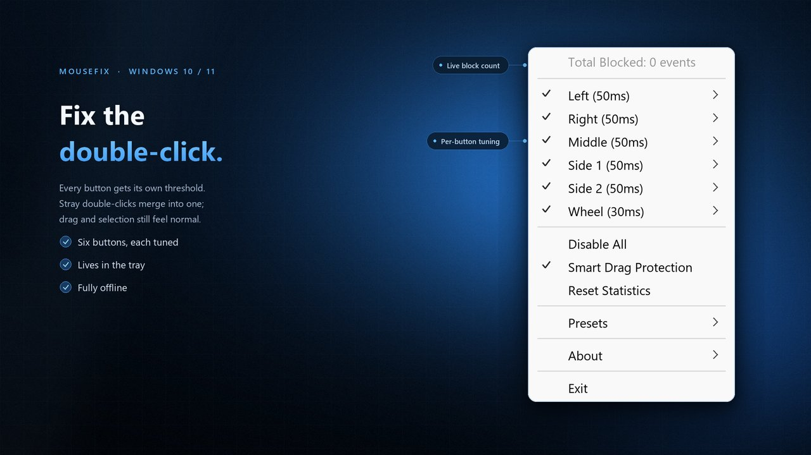
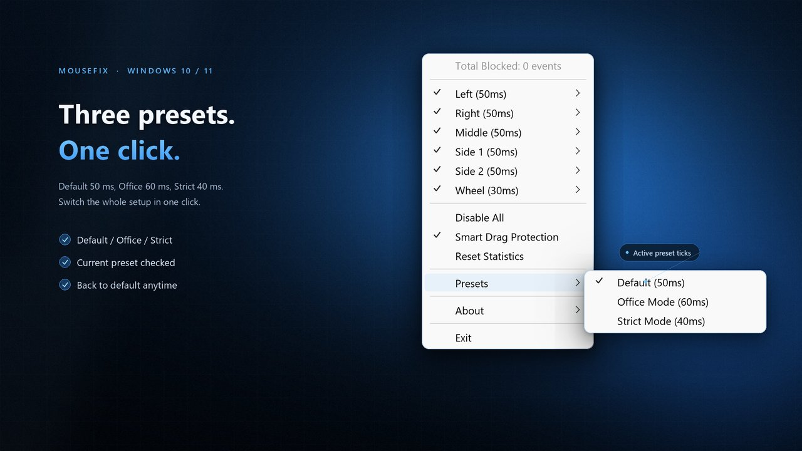

# MouseFix

A Windows tray app for mice whose switches have worn out: one click that fires twice, a wheel that jumps backwards, a drag that lets go halfway.

[中文说明 →](README.zh-CN.md)

## Install

**[MouseFix on the Microsoft Store](https://apps.microsoft.com/detail/9PD5WFXK17TT)** — signed by Microsoft, installed and removed through Windows, starts with Windows by default, updates itself. There is a 1-day trial; after that it is a one-time purchase, with local pricing on the Store page.

## What it fixes

- **One click registers as two.** You click a filename and land in rename mode. You fire once in a game and get two shots.
- **The wheel jumps backwards.** You scroll down and the page lurches up.
- **Drags release halfway.** Files drop while you are still moving the cursor.

The usual cause is a worn switch or wheel encoder. Worn contacts bounce: one press produces several make/break signals, and Windows treats each as a separate click. Replacing the switch is the real fix, but it means opening the mouse and soldering.

MouseFix installs a low-level mouse hook and drops duplicate signals inside a short time window. Real clicks pass through untouched.

## What it doesn't do

- **It doesn't repair hardware.** If the switch is dead — no click at all, or constant chatter — replace it. MouseFix is for switches that still work but bounce.
- **It doesn't change mouse settings.** No DPI, acceleration, button mapping or pointer speed.
- **It doesn't block synthetic clicks.** Mouse events generated by other software pass through as they are.

## Screenshots

The tray menu holds the global switch, per-button switches with their own thresholds, presets and the blocked counter.

Three presets cover most cases; every button can also be tuned on its own, from 1 to 200 ms.

## Presets

| Preset | Button threshold | Wheel threshold | Use |
| :--- | :---: | :---: | :--- |
| Default | 50ms | 30ms | Everyday use |
| Office | 60ms | 35ms | Heavier bounce |
| Strict | 40ms | 20ms | Fast clicking, e.g. games |

The threshold is the minimum gap between two signals. Higher filters more but can swallow intentional fast clicks; lower is more responsive but lets more bounce through. Start with Default and adjust individual buttons if needed.

## New in 1.0.9

- **Touchpads no longer lose taps.** A second button-down arriving before its matching up used to move the button into a blocked state and drop the real release. Duplicate downs are now swallowed while the button stays pressed, so the click is delivered.
- **Smart Drag is per button**, on for the left button only by default. Right-button debounce can stay on while right Smart Drag is off, which fixes the MouseInc gesture focus problem reported in #4.
- The old global Smart Drag setting migrates per button (on → left only, off → all off), writing the new values before deleting the old one.
- Duplicate downs no longer count twice in the blocked counter, and Reset Statistics no longer throws away a pending release.
- The release timer is no longer pushed back by every mouse event, and the version string lives in one header.

## Source and builds

The code here tracks the latest build — currently **1.0.9** — so nothing is lagging behind the Store version. What stopped is the packaging side: no installers, no new Releases. Signing, updates and refunds live with the Store, and duplicating that here only creates two versions of the truth.

If you would rather compile it yourself, open `MouseFix/MouseFix.sln` in Visual Studio 2022 (Desktop C++), pick Release, and build x64, x86 or ARM64. `build_release.bat` builds all three. The result is unsigned, so SmartScreen may mention an unknown publisher. Settings live in `HKCU\Software\MouseFix`; for autostart, put `add_to_startup.ps1` next to the exe and run it.

## No nag screens

No popups asking you to buy, no countdown, no "activate now" window. When the trial runs out the filtering simply stops, you get one notification about it, and that is the end of the subject.

## If it saved a mouse for you

Then a coffee is welcome. The simplest way is buying it on the Store — same build, signed and auto-updating, and it is what pays for the next dead mouse to test against. Nothing in the app depends on it, and nothing changes if you don't.

## Privacy

No network access, no log files, no telemetry. The hook reads button type, cursor position and wheel direction to detect bounce; it does not record what you click or what you type. Details: [privacy policy](https://matreshka15.github.io/MouseFix/).

## Requirements

Windows 10 version 1809 or later, 64-bit (x64 or ARM64).

## License and credits

MIT License. Original project by [marvinlehmann](https://github.com/marvinlehmann); current version maintained by [matreshka15](https://github.com/matreshka15).

Bugs, false positives and compatibility reports: [Issues](https://github.com/matreshka15/MouseFix/issues) or matreshka999@icloud.com. Include your mouse model, Windows version and the threshold you were using — that is what makes a report reproducible.
