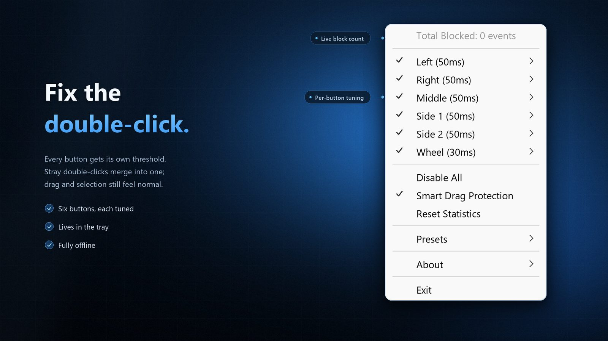

<h1 align="center">MouseFix</h1>

  Keep the mouse. Filter out the extra clicks. 
  Windows 10+ · 64-bit (x64 / ARM64) · MIT · 1-day trial, then a one-time purchase

  <a href="https://apps.microsoft.com/detail/9PD5WFXK17TT">
    <picture>
      <source media="(prefers-color-scheme: dark)" srcset="assets/store-badge-en-light.svg">
      
    </picture>
  </a>

<a href="README.zh-CN.md">中文说明 →</a>

## The signs of a worn mouse

- A single click on a filename switches it to rename mode.

- The page jumps back up while you scroll down.

- Halfway through dragging a file or selecting text, the button lets go.

Your mouse is not done for; it has just become more talkative. Oxidized contacts in a switch or wheel encoder turn one press into several signals, and Windows believes every one of them.

A new mouse is the expensive fix. This is the cheap one: nothing to open, nothing to solder, and the mouse you already know keeps working.

## What MouseFix does

MouseFix catches those extra signals before Windows acts on them. Duplicates inside a short time window get dropped; your real clicks go through.

You can leave it in the tray and forget about it while you get on with your work.

## What MouseFix does not do

- Hardware repair is not its job; a switch that never responds or never stops chattering needs replacing.
- DPI, acceleration, button mapping and pointer speed stay as you set them.
- Mouse events from other software go straight through.

## Install

The [Microsoft Store](https://apps.microsoft.com/detail/9PD5WFXK17TT) is the easy route. Microsoft signs the build, and Windows takes care of installing and removing it. It starts with Windows by default; you can turn that off in `Settings > Apps > Startup`.

You get a 1-day trial, then a one-time purchase. No subscription, no renewals. The Store page shows the price for your region.

The source here keeps pace with the latest version, currently 1.0.9. Older changes are in [CHANGELOG.md](CHANGELOG.md).

Build your own copy

1. Open `MouseFix/MouseFix.sln` in Visual Studio 2022.
2. Select `Release`, then build `x64`, `x86` or `ARM64`. Run `build_release.bat` to build all three at once.
3. A self-built copy is unsigned, so SmartScreen may report an unknown publisher.
4. It does not register itself for startup. Put `add_to_startup.ps1` in the same folder as the exe and run it once.

Settings are stored in `HKCU\Software\MouseFix`.

The source is MIT, so building it yourself is always an option. What the Store copy adds is the signing, the updates, and an installer you don't have to rebuild for every release.

The Store is now where new releases land, so there are no new installer packages. The standalone v1.0.4 exe is still in [Releases](https://github.com/matreshka15/MouseFix/releases); it works, and it stays pinned at that version.

## Thresholds and presets

| Preset | Buttons | Wheel |
| :--- | ---: | ---: |
| Default | 50 ms | 30 ms |
| Office | 60 ms | 35 ms |
| Strict | 40 ms | 20 ms |

Every mouse ages a little differently, so left, right, middle, X1, X2 and the wheel each get their own threshold, from 1 to 200 ms.

Since 1.0.9, you can turn Smart Drag protection on or off for each button. By default, it is on only for the left button.

Turn the threshold up and you catch more chatter, though a deliberate burst of fast clicks may get caught too. Turn it down and fast clicking feels more responsive, but more chatter gets through.

## No nag screens

MouseFix will not stop you with a purchase window, a countdown or an activation screen. When the trial ends, filtering quietly stops and you get one notification.

Apart from that expiry notice, the only prompt is a Store rating request. It appears once after 200 blocked events or one week from first run, then leaves you alone.

## Privacy

MouseFix stays on your computer. It does not connect to the network, write logs or collect telemetry, and Release builds leave the logging module out of the binary entirely.

The hook only looks at button type, cursor position and wheel direction. It never records what you click or what you type.

## Support

The Store copy is the paid one, and it is what keeps this project going: it covers Microsoft's cut and the second-hand mice I test against. If MouseFix saved you a mouse, that copy is the easiest way to say thanks ☕. If not, nothing changes, and the source stays open.

## License and bug reports

MIT License. Original project by [marvinlehmann](https://github.com/marvinlehmann), currently maintained by [matreshka15](https://github.com/matreshka15).

If MouseFix misreads your mouse, tell me in [Issues](https://github.com/matreshka15/MouseFix/issues). The mouse model, Windows version and threshold you were using make the problem reproducible.
