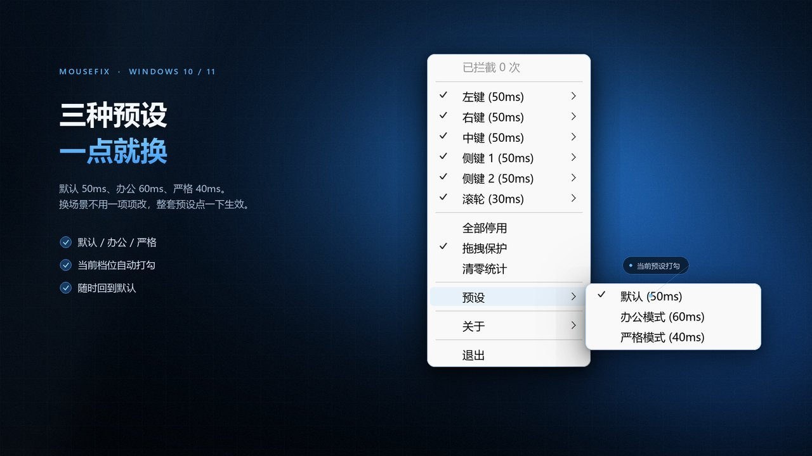

<h1 align="center">MouseFix</h1>

  别急着换鼠标。多出来的那些点击，滤掉就行。 
  Windows 10 及以上 · 64 位（x64 / ARM64） · MIT · 1 天试用，之后一次性买断

  <a href="https://apps.microsoft.com/detail/9PD5WFXK17TT">
    <picture>
      <source media="(prefers-color-scheme: dark)" srcset="assets/store-badge-zh-light.svg">
      
    </picture>
  </a>

<a href="README.md">English →</a>

## 鼠标老化后的表现

- 点一下文件名，结果直接进了重命名。

- 往下滚网页，页面却往回窜一段。

- 拖文件或选文字，拖到一半，按键自己松开了。

鼠标还没坏，只是话变多了。微动开关或滚轮编码器的触点氧化后，按一次会抖出好几个信号，Windows 把每个信号都当了真。

换一只新鼠标是最贵的解法。这个便宜：不用拆壳，不用动烙铁，你已经用顺手的这只继续干活。

## MouseFix 管什么

MouseFix 在 Windows 收到这些信号之前，把多出来的那几下拦下来。短时间窗内的重复信号丢掉，你的真实点击照常放行。

它就安安静静待在托盘里，你接着忙自己的。

## 它不管什么

- 修硬件不是它的活；按下去完全没反应，或者连击停不下来，就得换微动。
- DPI、加速度、按键映射和指针速度都照旧，MouseFix 不碰。
- 其他软件生成的鼠标事件，直接放行。

## 安装

想少折腾，就从[微软商店](https://apps.microsoft.com/detail/9PD5WFXK17TT)装。商店版有微软签名，装和卸都交给 Windows。它默认跟着 Windows 开机启动，不想这样的话，到「设置 > 应用 > 启动」里关掉。

先试用 1 天，之后一次性买断。不是订阅，也不会自动续费。你所在地区的价格写在商店页。

这里的源码一直跟着最新版走，当前是 1.0.9，更早的改动在 [CHANGELOG.md](CHANGELOG.md)。

自己编一份

1. 用 Visual Studio 2022 打开 `MouseFix/MouseFix.sln`。
2. 选 `Release`，可以编 `x64`、`x86` 或 `ARM64`；`build_release.bat` 一次编三个。
3. 自编译没有签名，SmartScreen 可能提示未知发布者。
4. 它也不会自动开机启动，把 `add_to_startup.ps1` 放到 exe 同目录，跑一次。

设置存在 `HKCU\Software\MouseFix`。

源码是 MIT 的，自己编当然可以，一分钱不用花。商店那份多给的是签名、自动更新，还有一个不用每次发版都重新编的安装包。

商店版之后不再出新安装包。[Releases](https://github.com/matreshka15/MouseFix/releases) 里还留着 v1.0.4 的独立 exe，能正常用，就固定停在那个版本。

## 阈值和预设

| 预设 | 按键阈值 | 滚轮阈值 |
| :--- | ---: | ---: |
| 默认 | 50ms | 30ms |
| 办公 | 60ms | 35ms |
| 严格 | 40ms | 20ms |

每只鼠标抖起来的脾气都不太一样，左键、右键、中键、侧键 X1、侧键 X2 和滚轮都能单独调，范围 1–200ms。

Smart Drag 拖拽保护从 1.0.9 起也按按键单独开关，默认只开左键。

想滤得狠一点，就把阈值调大，只是故意的快速连点也可能被吃掉。想让快速连点更跟手，就调小一点，代价是漏进来的抖动会多一些。

## 不弹窗催你买

MouseFix 不会拿购买窗口、倒计时或激活窗口打断你。试用到期后，过滤悄悄停下，只提示一次。

除了这次到期提示，它只会再问一次商店评价：拦满 200 次，或首次运行满一周时出现，之后就不来打扰你了。

## 隐私

MouseFix 不联网，不写日志，也不收集遥测，你的使用数据不会离开这台电脑。Release 编译里，日志模块整段不会进二进制。

钩子只看按键类型、光标位置和滚轮方向，不记录你点了什么，也不记录键盘输入。

## 支持 MouseFix

商店那份是付费版，也是这个项目能继续跑下去的原因：微软的抽成、我买回来复现 bug 的二手旧鼠标，都从这里出。要是它替你省下了一只鼠标，商店买一份就是最省事的道谢 ☕。不买也什么都不影响，源码一直开着。

## 许可和问题反馈

MIT License。原作者 [marvinlehmann](https://github.com/marvinlehmann)，当前由 [matreshka15](https://github.com/matreshka15) 维护。

遇到不对劲的地方，在 [Issues](https://github.com/matreshka15/MouseFix/issues) 告诉我。带上鼠标型号、Windows 版本和当时用的阈值，这三样齐了才复现得出来。
