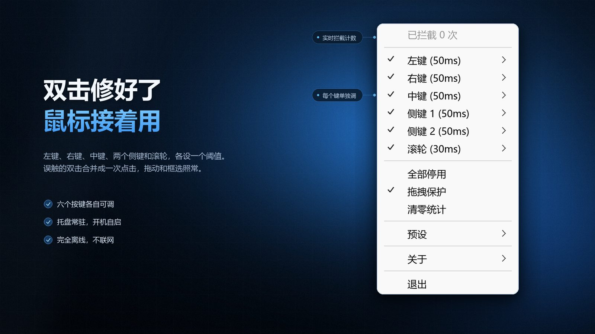

<h1 align="center">MouseFix</h1>

  别急着换鼠标。它只是微动老了。

  <a href="https://apps.microsoft.com/detail/9PD5WFXK17TT">
    <picture>
      <source media="(prefers-color-scheme: dark)" srcset="assets/store-badge-zh-light.svg">
      
    </picture>
  </a>

<a href="README.md">English →</a>

## 鼠标老化的样子

- 点一下文件名，它跳进了重命名。

- 页面向下滚，它自己往回蹦一截。

- 拖文件、框选文字，拖到一半，键自己松了。

这些现象大多来自同一个原因：微动开关与滚轮编码器长期使用后，触点氧化，单次按压会产生多次通断信号，Windows 会把这些信号全部识别为独立点击。

更换新鼠标可以彻底解决，但成本较高。如果鼠标本体仍然可用，MouseFix 可以在不拆壳、不动烙铁的前提下继续使用。

## 工作原理

MouseFix 在 Windows 接收鼠标消息之前进行拦截：多余的抖动信号被过滤，正常点击原样放行。

安装后无需配置，程序驻留系统托盘静默运行。

日常使用无感知延迟。

拖拽保护是唯一的例外：按住拖动后松开，操作最多延迟 150ms 才生效，用于区分拖拽与抖动。该功能默认仅对左键开启。

## 安装

系统要求：Windows 10 及以上，64 位系统（x64 或 ARM64）。

| | [微软商店](https://apps.microsoft.com/detail/9PD5WFXK17TT) | 自己编译 |
| :--- | :--- | :--- |
| 多少钱 | ¥12.9，可试用 | 免费 |
| 签名 | 微软签过名，SmartScreen 不拦 | 没有签名，可能提示未知发布者 |
| 装和卸 | 交给 Windows | 自己找个目录放，不想要了自己删 |
| 更新 | 自动 | 每个新版自己重编 |
| 开机自启 | 默认开，能在「设置 > 应用 > 启动」里关 | 不自动注册，跑一次 `add_to_startup.ps1` |
| 适合谁 | 装完就忘，不想管版本 | 想看代码、自己定版本 |

两列对应同一份源码，商店版即由本仓库编译而成。当前版本 1.0.9，更早的改动记录在 [CHANGELOG.md](CHANGELOG.md)。

从源码编译

1. 用 Visual Studio 2022 打开 `MouseFix/MouseFix.sln`。
2. 选 `Release`，编 `x64`、`x86` 或 `ARM64`；也可以跑 `build_release.bat`，一次编出三个架构。
3. 把 `add_to_startup.ps1` 放到 exe 同目录，跑一次，即可注册开机自启。

设置存在 `HKCU\Software\MouseFix`。

也可以用 legacy 版本：[Releases](https://github.com/matreshka15/MouseFix/releases) 里的 v1.0.4，独立 exe，下载下来双击就能跑。

## 阈值和预设

| 预设 | 按键阈值 | 滚轮阈值 |
| :--- | ---: | ---: |
| 默认 | 50ms | 30ms |
| 办公 | 60ms | 35ms |
| 严格 | 40ms | 20ms |

不同鼠标的抖动特性存在差异。左键、右键、中键、两个侧键及滚轮，共六个输入通道，均可独立设置阈值，调节范围为 1–200ms。

拖拽保护（Smart Drag）从 1.0.9 起支持按按键开关，默认只开左键。

上手不需要理解参数：从三组预设里选一个，窗口关掉就生效。数值调大，过滤更彻底，快速连点可能被一并拦截；调小则更跟手，但会漏过少量抖动。不满意再在预设基础上微调一两个档位即可。

## 支持 MouseFix

要是它帮你把手上这只多用几年，可以在商店买一份支持我 ❤️。不买也完全没关系，源码一直公开，想自己编一份随时都行。

## 隐私

MouseFix 不连接网络、不写入日志、不收集遥测数据，所有数据均保留在本机。正式发布版本的日志代码不参与编译，因此并不存在。

程序仅读取按键类型、指针位置与滚轮方向，不获取任何点击内容或键入文本。

## 许可

MIT License。原作者是 [marvinlehmann](https://github.com/marvinlehmann)，现在是我 [matreshka15](https://github.com/matreshka15) 在维护。

遇到问题，到 [Issues](https://github.com/matreshka15/MouseFix/issues) 说一声。附上鼠标型号、Windows 版本和当时用的阈值。
