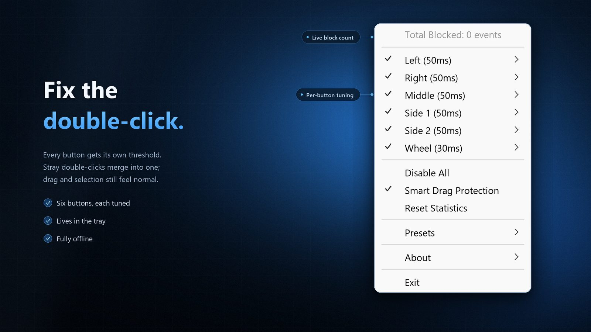
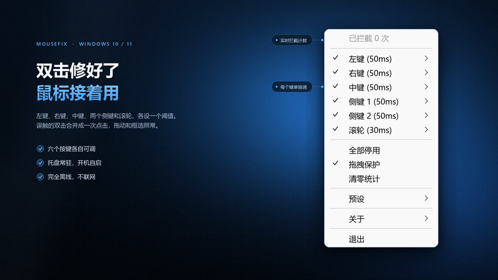

# MouseFix

Windows 托盘小工具，处理鼠标微动老化后的误触：单击变双击、滚轮反向跳、拖拽半路松手。

[English →](README.md)

## 安装

**[微软商店安装 MouseFix](https://apps.microsoft.com/detail/9PD5WFXK17TT)**，微软签名分发，装和卸都走 Windows，默认随系统启动，修复自动更新。有 1 天试用，之后一次性买断，各地价格以商店页为准。

## 它解决什么毛病

- **单击变双击。** 点一下文件名，直接进重命名；游戏里开一枪，出去两发。
- **滚轮反向跳。** 明明往下滚，页面突然往上窜一段。
- **拖拽中途断开。** 拖文件、选文字，拖到一半自己松手。

原因多半在微动开关和滚轮编码器：触点磨损、氧化之后，按一次会抖出好几个通断信号，Windows 把这些信号都当成独立操作。换微动是最彻底的办法，但要拆鼠标、动烙铁。

MouseFix 挂一个低级鼠标钩子，把短时间窗内的重复信号丢掉，真实点击照常放行。

## 它不做什么

- **不修硬件。** 微动彻底坏了——按下去没反应，或者一直连击——只能换微动。MouseFix 处理的是「还能用，但抖得烦人」的情况。
- **不改鼠标参数。** 不碰 DPI、加速度、按键映射，也不改指针速度。
- **不拦截模拟点击。** 其他软件生成的鼠标事件直接放行。

## 界面

托盘菜单里有总开关、六个按键各自的开关和阈值、预设、拦截计数。

三档预设覆盖大部分情况；单个按键也能自己调，范围 1–200ms。

## 预设

| 预设 | 按键阈值 | 滚轮阈值 | 适合 |
| :--- | :---: | :---: | :--- |
| 默认 | 50ms | 30ms | 日常使用 |
| 办公 | 60ms | 35ms | 抖动比较严重 |
| 严格 | 40ms | 20ms | 需要快速连点，比如游戏 |

阈值是两次信号之间允许的最小间隔。调大，过滤更狠，真实的快速连点也可能被吃掉；调小，响应更快，漏掉的抖动会多一些。拿不准就先用默认，再给单个按键微调。

## 1.0.9 修了什么

- **触摸板点击不再被吞。** 触摸板在 up 之前可能先发第二个 down，旧状态机把它当成抖动，切到 BLOCKED 之后把真正的 up 丢了。现在重复 down 只吞那一个信号，按键保持按下，真实 up 正常放行。
- **Smart Drag 改成按按键单独开关**，默认只开左键。右键可以只保留防抖、把 Smart Drag 关掉，issue #4 里 MouseInc 手势启动程序拿不到焦点的问题就是这么解决的。
- 旧的全局 Smart Drag 设置按按键迁移（旧版开 → 只开左键，旧版关 → 全关），先写新值再删旧值。
- 重复 down 不再重复计入拦截计数；Reset 统计不再把待发的 up 一起清掉。
- 释放定时器不再被每个鼠标事件重置；版本号收口到一个头文件。

## 源码和构建

这里的代码始终跟最新版本同步，当前是 **1.0.9**，不存在比商店慢一版的情况。停掉的只是打包：不再放安装包，也不再发新的 Release。签名、更新、退款这些事在商店那边，仓库再做一遍只会多出一个版本真相。

想自己编译，用 Visual Studio 2022 打开 `MouseFix/MouseFix.sln`，选 Release，x64、x86、ARM64 都能出；`build_release.bat` 一次编三个。自己编的 exe 没有签名，SmartScreen 可能提示「未知发布者」。设置存在 `HKCU\Software\MouseFix`；要开机自启，把 `add_to_startup.ps1` 和 exe 放同一目录运行。

## 不弹窗催你买

没有购买弹窗，没有倒计时，也没有「立即激活」的窗口。试用到期之后过滤悄悄停下，提示一次，然后这件事就结束了。

## 觉得好用的话

买一杯咖啡就好。最省事的方式是在商店里买一份——同一份程序，签名和自动更新都齐，也是下一只用来试错的老鼠标的钱从哪来的。程序本身不依赖这个，不买也什么都不影响。

## 隐私

不联网、不写日志、不上传数据。钩子只读取按键类型、光标位置和滚轮方向，用来判断抖动；不记录你点了什么，也不记录键盘输入。细节见[隐私政策](https://matreshka15.github.io/MouseFix/)。

## 系统要求

Windows 10 1809 或更高版本，64 位（x64 或 ARM64）。

## 许可证与出处

MIT License。原始项目由 [marvinlehmann](https://github.com/marvinlehmann) 编写，当前版本由 [matreshka15](https://github.com/matreshka15) 维护。

问题、误报和兼容性反馈请提到 [Issues](https://github.com/matreshka15/MouseFix/issues)，或发邮件到 matreshka999@icloud.com。提问题时带上鼠标型号、Windows 版本和当时的阈值，这三样齐了才复现得出来。
